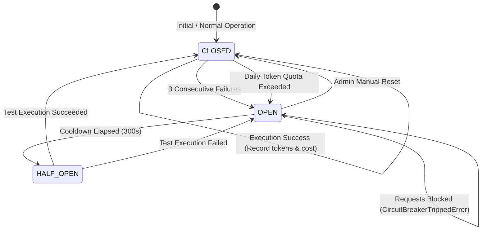

# Talox Tech Stream — Architecture Specification

## 1. Executive Summary

Talox Tech Stream is a modular, production-oriented, multi-tenant SaaS platform delivering automated AI business services across multiple industries.

Key architectural pillars:
- **Zero Visual Tools (No n8n):** 100% custom Python automation engine using asyncio, APScheduler, and database-backed task queues.
- **Strict Multi-Tenant Isolation:** Supabase PostgreSQL with Row Level Security (RLS) on all tenant-owned tables and server-side tenant context validation.
- **DeepSeek Smart Model Routing:** Automatic tiering via DeepSeek API (`https://api.deepseek.com`) between `deepseek-chat` (fast/structured workloads) and `deepseek-reasoner` (complex reasoning/audits), with offline mock fallback.
- **Cost Protection & Circuit Breaker:** SlowAPI rate limiting, tenant token quotas, and automated circuit breaking after consecutive failures to prevent runaway billing.
- **Meta Embedded Signup:** Frictionless self-service WhatsApp Business onboarding.
- **Data Privacy & GDPR Right-to-be-Forgotten:** Pre-AI PII and financial sanitization pipeline + atomic cascading account deletion.

---

## 2. Logical System Architecture

```text
+-----------------------------------------------------------------------------------+
|                                  CLIENT LAYER                                     |
|  Next.js 14 (App Router, static export) + TypeScript + Tailwind CSS +             |
|  TanStack Query + Lucide React + Recharts (served via FastAPI /app/static)        |
|  - Client Multi-Tenant Dashboard (Overview, Business Tracking, WhatsApp, Billing) |
|  - Owner Admin Console (Tenants, Global Revenue, Agent Controls, Approvals)       |
+-----------------------------------------------------------------------------------+
                                        | (Same-origin HTTPS / REST)
                                        v
+-----------------------------------------------------------------------------------+
|                                  API GATEWAY                                      |
|  FastAPI + SlowAPI Rate Limiting + CORS + Static Export Hosting + JSON Envelope   |
|  /api/v1/auth, /api/v1/tenants, /api/v1/business, /api/v1/finance,                |
|  /api/v1/marketing, /api/v1/agents, /api/v1/approvals, /api/v1/integrations,      |
|  /api/v1/assistant, /api/v1/admin, /api/v1/health                                 |
+-----------------------------------------------------------------------------------+
                                        |
         +------------------------------+-------------------------------+
         v                                                              v
+-----------------------------------+          +------------------------------------+
|     CORE PLATFORM SERVICES        |          |      CUSTOM PYTHON AUTOMATION      |
| - TenantService (Lifecycle/Purge) |          | - Runtime Engine (asyncio)         |
| - BusinessService & FinanceService|          | - BudgetManager & Circuit Breaker  |
|   (Immutable Ledger / Rent)       |          | - ApprovalManager (Human-in-loop)  |
| - BillingService (Subscriptions)  |          | - EventBus & Scheduler             |
| - Security (PII Sanitization)     |          |                                    |
+-----------------------------------+          +------------------------------------+
         |                                                              |
         |                                                              v
         |                                     +------------------------------------+
         |                                     |         MULTI-AGENT LAYER          |
         |                                     | - Master Routing Agent             |
         |                                     | - Planner & Researcher Agents      |
         |                                     | - Business & Marketing Agents      |
         |                                     | - Reviewer Agent (Validation)      |
         +----------------------+              +------------------------------------+
                                |                               |
                                v                               v
+-----------------------------------+          +------------------------------------+
|          DATABASE TIER            |          |         INTEGRATION TIER           |
|  Supabase PostgreSQL (eu-west-1)  |          | - DeepSeek API (Smart AI Routing)  |
|  - Row Level Security (RLS)       |          | - Meta WhatsApp Embedded Signup    |
|  - Tenant-isolated tables         |          | - Webhook Signature Verification   |
|  - Cascade Deletes & Audit Trails |          | - Payment Rails (Manual / Mock)    |
+-----------------------------------+          +------------------------------------+
```

---

## 3. Cost-Protection & Circuit Breaker Architecture

The `BudgetManager` provides active defenses against runaway loops and excessive API spend:



---

## 4. Smart Model Routing Flow

```text
Incoming Task
    │
    ▼
[Data Sanitization] ───► Strip PII, Credit Cards, CVVs, Passwords, IBANs
    │
    ▼
[Budget & Circuit Check] ───► Verify remaining token quota & CLOSED circuit
    │
    ▼
[Complexity Classifier]
    ├── Simple / High Volume  ───► deepseek-chat ($0.14 in / $0.28 out per 1M tokens)
    └── Reasoning / Audit     ───► deepseek-reasoner ($0.55 in / $2.19 out per 1M tokens)
    │
    ▼
[DeepSeek API Gateway (api.deepseek.com)]
    │
    ▼
[Record Usage & Costs] ───► Update tenant daily tokens & audit ledger
```

---

## 5. Security Guardrails

1. **Service Role Keys:** Server-side only; never bundled in frontend code or client responses.
2. **Tenant ID Injection Defense:** Tenant ID is derived solely from authenticated JWT / session tokens on the server, never trusted from client payloads.
3. **Sensitive Action Gates:** Financial refunds, campaign publishing, and record deletions require human approvals through the `ApprovalManager`.
4. **Data Redaction:** The `sanitize_ai_prompt` filter runs ahead of any prompt dispatch to prevent privacy leaks.
5. **Cascading Data Purge:** Tenant termination executes an atomic purge across all child tables with audit confirmation.

---

## 6. Runtime & Hosting Topology

- **DNS & Edge Routing:** Cloudflare manages authoritative DNS for `teloxtech.stream` in DNS-only (unproxied) mode, pointing apex `A` records to Render edge IPs and `www.teloxtech.stream` `CNAME` to Render (`new-folder-4-hp6h.onrender.com`).
- **Unified Container (`Dockerfile`):** Stage 1 (`node:20-alpine`) exports the Next.js static SPA (`frontend/out`) with `NEXT_PUBLIC_BACKEND_URL=""`; Stage 3 (`python:3.12-slim`) runs Uvicorn/FastAPI on `$PORT` (default `10000`), serving `/app/static` and `/api/v1/*` from one origin.
- **Hosting Platforms:** **Render** (`render.yaml`, primary live host for `https://teloxtech.stream` with Render-managed TLS) and **Railway** (`railway.toml`, secondary host `talox-tech-stream-production.up.railway.app`).
- **Database:** **Supabase** PostgreSQL (`pmmduhflikdvddzpgwsi`, `eu-west-1`) accessed via async SQLAlchemy (`SUPABASE_DATABASE_URL`) and Supabase SDK.
