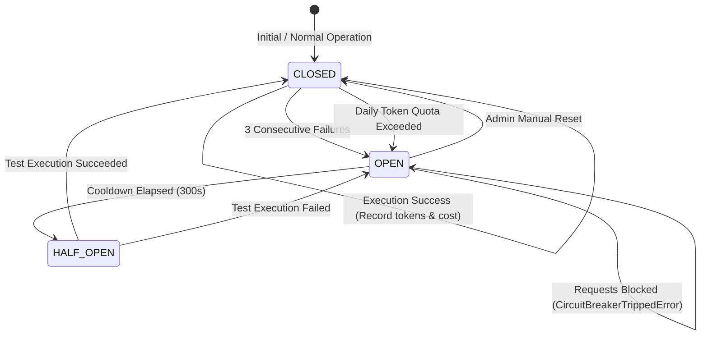

# Talox Tech Stream — Architecture Specification

## 1. Executive Summary

Talox Tech Stream is a modular, production-oriented, multi-tenant SaaS platform delivering automated AI business services across multiple industries.

Key architectural pillars:
- **Zero Visual Tools (No n8n):** 100% custom Python automation engine using asyncio, APScheduler, and database-backed task queues.
- **Strict Multi-Tenant Isolation:** Supabase PostgreSQL with Row Level Security (RLS) on all tenant-owned tables and server-side tenant context validation.
- **OpenRouter Smart Model Routing:** Automatic tiering between cost-efficient models (`google/gemini-flash-1.5` / `openai/gpt-4o-mini`) and deep reasoning models (`anthropic/claude-3.5-sonnet`).
- **Cost Protection & Circuit Breaker:** SlowAPI rate limiting, tenant token quotas, and automated circuit breaking after consecutive failures to prevent runaway billing.
- **Meta Embedded Signup:** Frictionless self-service WhatsApp Business onboarding.
- **Data Privacy & GDPR Right-to-be-Forgotten:** Pre-AI PII and financial sanitization pipeline + atomic cascading account deletion.

---

## 2. Logical System Architecture

```text
+-----------------------------------------------------------------------------------+
|                                  CLIENT LAYER                                     |
|  Next.js 14 (App Router) + TypeScript + Tailwind CSS + Lucide React + Recharts     |
|  - Client Multi-Tenant Dashboard (Overview, Business Tracking, WhatsApp, Billing) |
|  - Owner Admin Console (Tenants, Global Revenue, Agent Controls, Approvals)       |
+-----------------------------------------------------------------------------------+
                                        | (HTTPS / REST / WebSockets)
                                        v
+-----------------------------------------------------------------------------------+
|                                  API GATEWAY                                      |
|  FastAPI + SlowAPI Rate Limiting + CORS + Standard JSON Envelope                  |
|  /api/v1/auth, /api/v1/tenants, /api/v1/business, /api/v1/marketing, /admin      |
+-----------------------------------------------------------------------------------+
                                        |
         +------------------------------+-------------------------------+
         v                                                              v
+-----------------------------------+          +------------------------------------+
|     CORE PLATFORM SERVICES        |          |      CUSTOM PYTHON AUTOMATION      |
| - TenantService (Lifecycle/Purge) |          | - Runtime Engine (asyncio)         |
| - BusinessService (Double-entry)  |          | - BudgetManager & Circuit Breaker  |
| - BillingService (Subscriptions)  |          | - ApprovalManager (Human-in-loop)  |
| - Security (PII Sanitization)     |          | - EventBus & Scheduler             |
+-----------------------------------+          +------------------------------------+
         |                                                              |
         |                                                              v
         |                                     +------------------------------------+
         |                                     |         MULTI-AGENT LAYER          |
         |                                     | - Master Routing Agent             |
         |                                     | - Planner & Researcher Agents      |
         |                                     | - Business & Marketing Agents      |
         |                                     | - Reviewer Agent (Validation)      |
         +----------------------+              +------------------------------------+
                                |                               |
                                v                               v
+-----------------------------------+          +------------------------------------+
|          DATABASE TIER            |          |         INTEGRATION TIER           |
|  Supabase PostgreSQL              |          | - OpenRouter (Smart AI Routing)    |
|  - Row Level Security (RLS)       |          | - Meta WhatsApp Embedded Signup    |
|  - Tenant-isolated tables         |          | - Webhook Signature Verification   |
|  - Cascade Deletes & Audit Trails |          | - Payment Rails (Stripe/Manual)    |
+-----------------------------------+          +------------------------------------+
```

---

## 3. Cost-Protection & Circuit Breaker Architecture

The `BudgetManager` provides active defenses against runaway loops and excessive API spend:



---

## 4. Smart Model Routing Flow

```text
Incoming Task
    │
    ▼
[Data Sanitization] ───► Strip PII, Credit Cards, CVVs, Passwords, IBANs
    │
    ▼
[Budget & Circuit Check] ───► Verify remaining token quota & CLOSED circuit
    │
    ▼
[Complexity Classifier]
    ├── Simple / High Volume  ───► google/gemini-flash-1.5 ($0.075 / 1M tokens)
    └── Reasoning / Audit     ───► anthropic/claude-3.5-sonnet ($3.00 / 1M tokens)
    │
    ▼
[OpenRouter Gateway]
    │
    ▼
[Record Usage & Costs] ───► Update tenant daily tokens & audit ledger
```

---

## 5. Security Guardrails

1. **Service Role Keys:** Server-side only; never bundled in frontend code or client responses.
2. **Tenant ID Injection Defense:** Tenant ID is derived solely from authenticated JWT / session tokens on the server, never trusted from client payloads.
3. **Sensitive Action Gates:** Financial refunds, campaign publishing, and record deletions require human approvals through the `ApprovalManager`.
4. **Data Redaction:** The `sanitize_ai_prompt` filter runs ahead of any prompt dispatch to prevent privacy leaks.
5. **Cascading Data Purge:** Tenant termination executes an atomic purge across all child tables with audit confirmation.
